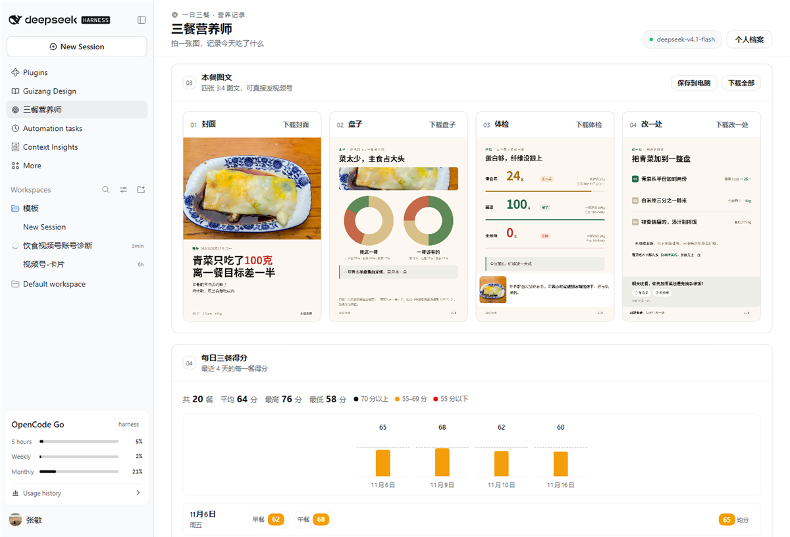
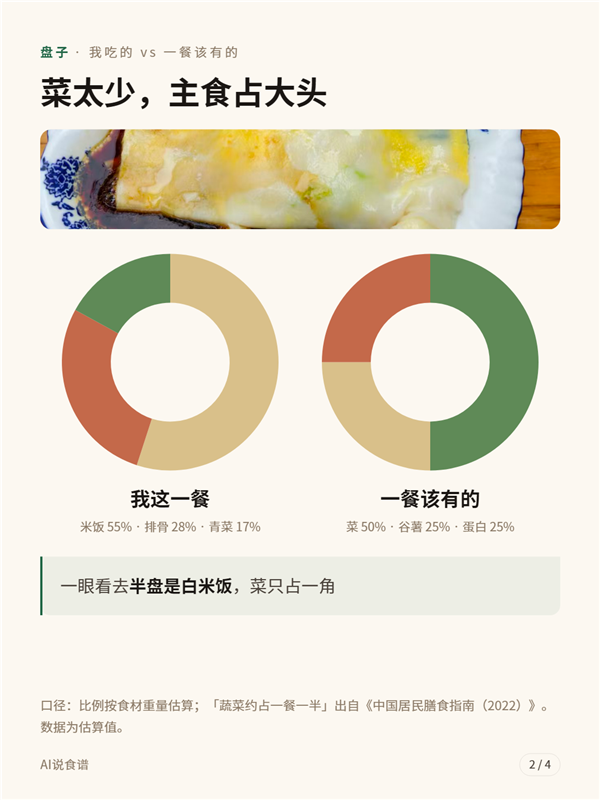
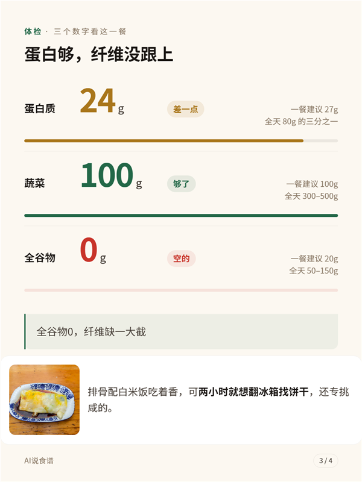
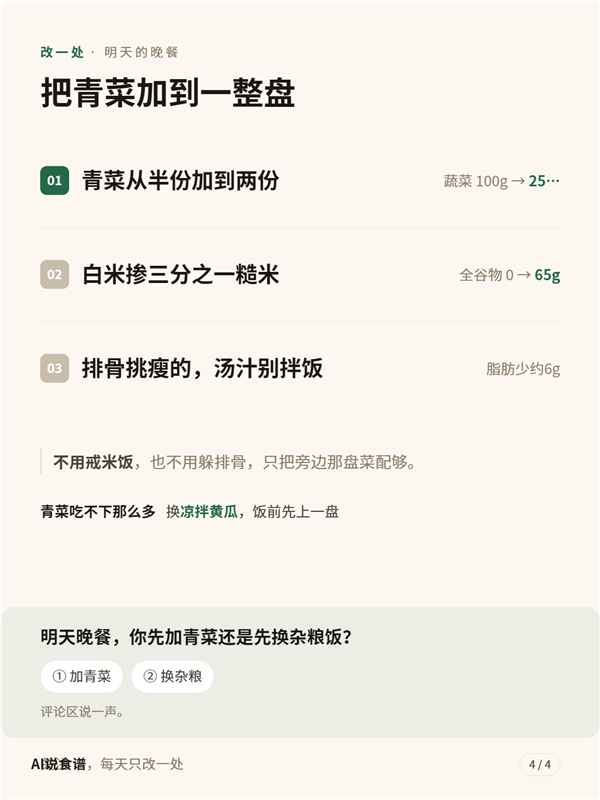

# 三餐营养师 · dsh-nutrition-desk

DeepSeek Harness 的一个插件：**填一次个人档案，输入当餐吃了什么，AI 出一套四页视频号图文 + 一段可直接发布的文案。**

四页的分工固定，像连载：封面抓人 → 盘子看结构 → 体检看数字 → 最后一页给一个能立刻做的改动。

<p>
  
</p>

<table>
<tr>
<td></td>
<td></td>
<td></td>
<td></td>
</tr>
<tr>
<td align="center"><sub>01 封面</sub></td>
<td align="center"><sub>02 盘子</sub></td>
<td align="center"><sub>03 体检</sub></td>
<td align="center"><sub>04 改一处</sub></td>
</tr>
</table>

## 四页各干什么

| 页 | 回答的问题 | 内容 |
| --- | --- | --- |
| 01 封面 | 这跟我有关系吗？ | 满幅实拍照片 + 场景/日期 + 两行大标题（数字标红）+ 两句说明 + 左下身份 / 右下账号 |
| 02 盘子 | 凭什么这么说？ | 照片横条 + 两个环形图（我这一餐 vs 一餐该有的）+ 一句点破 + 口径说明 |
| 03 体检 | 差多少？ | 蛋白质 / 蔬菜 / 全谷物三个数字，带状态、进度条、建议值和一句人话点评 |
| 04 改一处 | 那我怎么办？ | 三条能当天做到的动作（右侧数字变化）+ 一句表态 + 一个替代方案 + 一个二选一提问 |

## 怎么用

1. **填一次个人档案**：性别、年龄、身高、体重、活动量、目标、自媒体账号（账号名会印在图片右下角）。存在本机，下次自动带出。
2. **记这一餐**：选餐次，写一句就行，例如 `早餐，一份鸡蛋肠`。写在句首的餐次会以你写的为准。
3. **加一张照片（可选）**：点选或直接粘贴，照片只在这台电脑上用，不会上传。没有照片也能生成（封面会用纸色底 + 这一餐的文字占位）。
4. **生成**：AI 结合身体数据和这一餐，估算热量、蛋白质、蔬菜、全谷物，写出四页需要的全部文案。
5. **发布**：点「保存到电脑」，落到 `文档/一日三餐营养师/<日期>-<餐次>/`，里面是四张 1080×1440 PNG 加一个 `05-图文文案.md`；也可以单张下载、单独复制正文或全文。

## 发布文案

```
早餐吃肠粉的都看看：蛋白只有 12 克

今天早餐：一份鸡蛋肠。
蛋白 12 克，蔬菜 0 克，全谷物 0 克。
热量不高，材料不对。
加一个蛋、一杯豆浆，蛋白到 27 克。
你早餐是「只有主食」，还是「主食＋蛋白」？

#AI说餐谱 #早餐 #上班族 #久坐族
```

正文一句一行，手机上好读；标签固定四个（账号话题 + 餐次 + 目标 + 人群）。身份信息已经印在封面左下角，正文里不再重复「备注」。

## 安装

要求 DeepSeek Harness `0.2.1-rc.5` 及以上的 `0.2.x`，并且已经在 DSH 里配好模型（插件自己不带密钥）。

```bash
# 从 GitHub 装
dsh plugin --profile desktop add git+https://github.com/poweredbyai/dsh-nutrition-desk.git

# 或者装本地目录
dsh plugin --profile desktop add /path/to/dsh-nutrition-desk
```

也可以在 DSH「插件 → 添加插件」里填仓库地址。装好后侧栏出现「三餐营养师」，点开即用。界面改动刷新页面生效；Host 侧改动需要重启 DSH。

## 没有模型也能用

模型不可用或输出不是合法 JSON 时，插件会用内置的常见食物表粗估，照样出四页图，并在界面上说明这次是本地估算（会先让模型重试一次紧凑输出）。

## 数据与隐私

- 档案、每一餐的记录：`~/.dsh/nutrition-desk/state.json`，全在本机。
- 生成的图片：`~/Documents/一日三餐营养师/`。
- **照片不上传**：只在浏览器里读进 canvas，从不发往 Host。
- 发出去的内容只有「这一餐吃了什么 + 身体数据」这一段，走你在 DSH 里配置的模型。
- 插件的 HTTP 接口都在 Host 侧鉴权，并拒绝跨站写请求；保存图片时只接受真实的 PNG。

营养数据是基于常见食物的估算，仅用于记录和参考，**不构成医疗或营养诊断建议**。

## 开发

```bash
node build.mjs                # 把 src/*.js 拼成 client.js（浏览器侧）
node --test tests/*.test.mjs  # Host 接口测试
```

| 文件 | 内容 |
| --- | --- |
| `index.js` | Host 半片：`/nutrition-desk/*` 接口、四页提示词、结果规范化（建议值/状态/进度条由 Host 算）、PNG 与文案落盘 |
| `src/card.js` | Canvas 2D 四页渲染器（纯函数，1080×1440，无依赖，支持照片裁切） |
| `src/panel.js` | React 整页面板（档案、这一餐、照片、四页预览、每日三餐得分） |
| `src/main.js` | 客户端注册：`main` 面板 + `sidebar.panellist` 入口 |
| `build.mjs` | 无依赖拼接构建 |
| `tests/` | Host 接口的单元测试（Node 内置 test runner） |

四页的字段规格、样式表（字号/间距/颜色）和文字上限写在 `docs/nutrition-desk-v2-cards.md`，改版式前先读它。

## License

MIT
