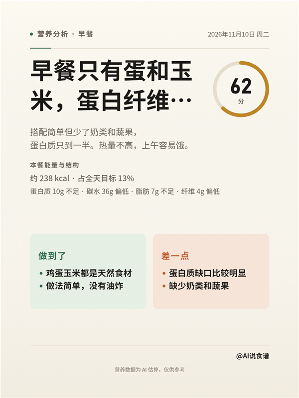
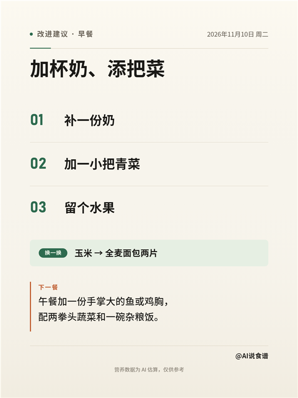
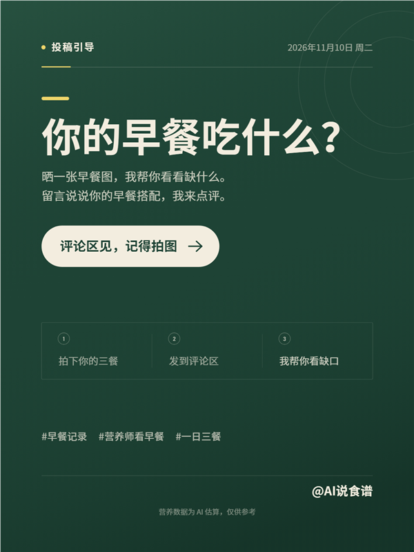
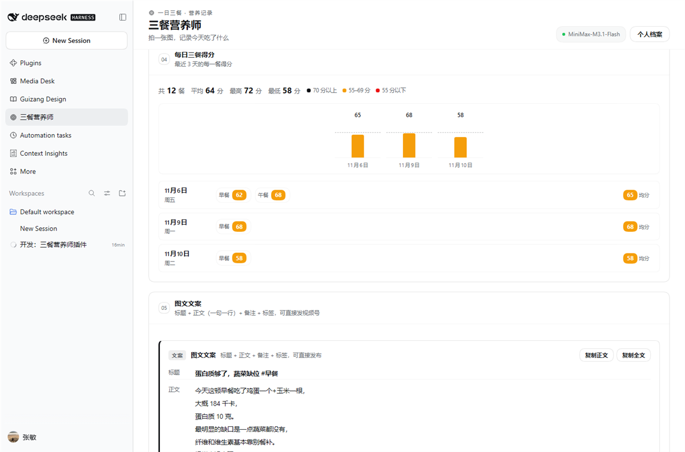

# 三餐营养师 · dsh-nutrition-desk

DeepSeek Harness 的一个插件：**填一次个人档案，输入当餐吃了什么，AI 生成三张视频号图文 + 一段可直接发布的文案。**

- 图片：营养分析 / 改进建议 / 引导粉丝投稿，各一张 1080×1440（3:4），右下角是你自己的账号水印。
- 文案：标题、约 100 字口语化正文（**一句一行**，手机上好读）、`备注：男、42岁、175cm、67kg`、四个话题标签。
- 面板：还能看到最近几天**每日三餐得分**的柱状趋势和每餐明细。

<p>
  
</p>

<table>
<tr>
<td></td>
<td></td>
<td></td>
</tr>
<tr>
<td align="center"><sub>01 营养分析</sub></td>
<td align="center"><sub>02 改进建议</sub></td>
<td align="center"><sub>03 引导投稿</sub></td>
</tr>
</table>

## 怎么用

1. **填一次个人档案**：性别、年龄、身高、体重、活动量、目标、自媒体账号。存在本机，下次打开自动带出，随时可改；填完立刻能看到每日参考热量和蛋白质目标（Mifflin-St Jeor 公式）。
2. **记这一餐**：选早餐 / 午餐 / 晚餐 / 加餐，写一句就行，比如 `早餐，鸡蛋一个+玉米一根`。
3. **生成营养图文**：AI 结合你的身体数据和这一餐，估算热量、蛋白质、碳水、脂肪、纤维，给出评分、结论和可执行的动作。
4. **发布**：点「保存到电脑」，落到 `文档/一日三餐营养师/<日期>-<餐次>/`，里面是三张 PNG 加一个 `04-图文文案.md`；也可以单张下载、单独复制正文或全文。

<p>
  
</p>

## 安装

要求 DeepSeek Harness `0.2.1-rc.5` 及以上的 `0.2.x`，并且已经在 DSH 里配好模型（插件自己不带密钥）。

**方式一：插件面板**

DSH 里打开「插件」→「添加插件」，粘贴仓库地址或包目录。

**方式二：命令行**

```bash
dsh plugin --profile desktop add git+https://github.com/poweredbyai/dsh-nutrition-desk.git
```

已经有本地目录的话，也可以直接装目录：

```bash
dsh plugin --profile desktop add /path/to/dsh-nutrition-desk
```

装好后侧栏会出现「三餐营养师」的图标，点开即用。界面改动刷新页面生效；Host 侧（提示词、接口）改动需要重启 DSH。

**升级**：重新执行一次 `add`；或换成 `file:` / `git+` 指向新版本。

## 三张图长什么样

| 图 | 内容 |
| --- | --- |
| 01 营养分析 | 评分圆环 + 一句话结论；「本餐能量与结构」用两行文字概括，不堆数字；底部两块浅色卡片突出「做到了 / 差一点」 |
| 02 改进建议 | 3 条动作只留标题、字够大；一个「换一换」替换建议；「下一餐怎么吃」 |
| 03 引导投稿 | 深绿海报：一句提问、三步参与方式、话题标签 |
| 图文文案 | 标题带 `#餐次`；正文一句一行；`备注：性别、年龄、身高、体重`；`#AI说餐谱 #早餐 #上班族 #久坐族` |

图片右下角的账号水印取档案里的**自媒体账号**，没填时回退为 `@AI说餐谱`；底部固定一行「营养数据为 AI 估算，仅供参考」。

## 没有模型也能用

模型不可用或返回不合法时，插件用内置的常见食物表做粗略估算，照样出三张图和文案，并在界面上说明这次是本地估算。接上模型后结果更准。

## 数据与隐私

- 档案、每一餐的记录：`~/.dsh/nutrition-desk/state.json`，全在本机。
- 生成的图片：`~/Documents/一日三餐营养师/`。
- 发出去的内容只有「这一餐吃了什么 + 身体数据」这一段，走你在 DSH 里配置的模型，不经过任何第三方服务器。
- 插件的 HTTP 接口都在 Host 侧鉴权，并拒绝跨站写请求；保存图片时只接受真实的 PNG，路径由服务端自己生成。

营养数据是基于常见食物的估算，仅用于记录和参考，**不构成医疗或营养诊断建议**。

## 开发

```bash
node build.mjs                # 把 src/*.js 拼成 client.js（浏览器侧）
node --test tests/*.test.mjs  # Host 接口测试
```

| 文件 | 内容 |
| --- | --- |
| `index.js` | Host 半片：`/nutrition-desk/*` 接口、提示词、结果规范化、PNG 与文案落盘 |
| `src/card.js` | Canvas 2D 卡片渲染器（纯函数，1080×1440，无依赖） |
| `src/panel.js` | React 整页面板（只用宿主主题 token，深浅色自动跟随） |
| `src/main.js` | 客户端注册：`main` 面板 + `sidebar.panellist` 入口 |
| `build.mjs` | 无依赖拼接构建 |
| `tests/` | Host 接口的单元测试（Node 内置 test runner） |

## License

MIT
